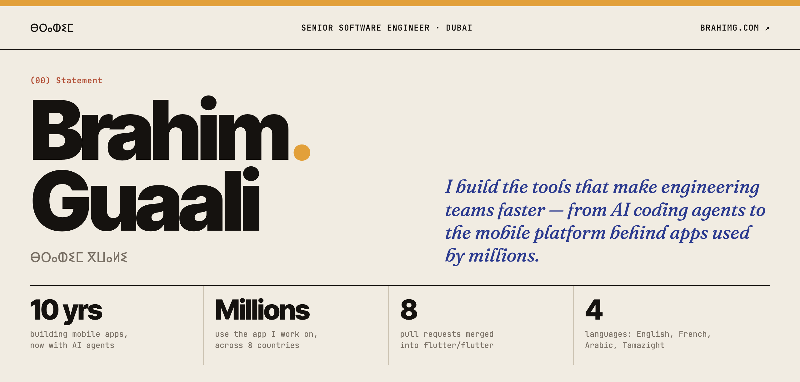

<a href="https://brahimg.com">
  <picture>
    <source media="(prefers-color-scheme: dark)" srcset="assets/banner-dark.png">
    
  </picture>
</a>

 

`(01) HOW I WORK`

### *Systems that hold up when things break.*

I like structure you can see: clear state, small steps, checkpoints, and checks that catch problems early. Mobile platform at [Talabat](https://www.talabat.com) by day: experimentation, observability, reliability on iOS and Android, and the AI developer tools engineers use every day.

 

`(02) INDEX OF WORK`

| `NO.` | `WORK` | `WHAT` | `YEAR` |
|:--|:--|:--|--:|
| `01` | **[flutter/flutter](https://github.com/flutter/flutter/pulls?q=is%3Apr+author%3Abrahim-guaali+is%3Amerged)** Open source contributor | Eight merged pull requests across the web tool, material, cupertino and widgets. | `2026` |
| `02` | **[Awal Terminal](https://github.com/AwalTerminal/Awal-terminal)** Creator | A macOS terminal for AI coding agents, in Rust, Swift and Metal. 36 releases; no longer in active development. | `2026` |
| `03` | **[Graph engineering from first principles](https://github.com/brahim-guaali/graph-engineering-from-first-principles)** Learning project | From a plain agent loop to a graph with checkpoints, idempotency and a verifier, one stage at a time. Stdlib Python, runs offline. | `2026` |

 

`(03) WRITING` · [all on Medium ↗](https://medium.com/@brahimg)

- [I rebuilt one AI agent seven times to understand graph engineering](https://medium.com/@brahimg/i-rebuilt-one-ai-agent-seven-times-to-understand-graph-engineering-80b9983cd921) &nbsp;`AI AGENTS`
- [HTTP/3 in Flutter: what changes, what you gain, and how to prove it](https://medium.com/@brahimg/http-3-in-flutter-what-changes-what-you-gain-and-how-to-prove-it-with-an-a-b-test-cf3c43f12bc1) &nbsp;`FLUTTER`
- [Documentation is becoming infrastructure in the AI era](https://medium.com/@brahimg/documentation-is-becoming-infrastructure-in-the-ai-era-3921f8b198c5) &nbsp;`PRACTICE`

 

`(04) ELSEWHERE` &nbsp; [brahimg.com](https://brahimg.com) · [LinkedIn](https://www.linkedin.com/in/brahim-guaali/) · [Medium](https://medium.com/@brahimg) · [X](https://x.com/real_brahimg)

ⴰⵣⵓⵍ — English · Français · العربية · ⵜⴰⵎⴰⵣⵉⵖⵜ
